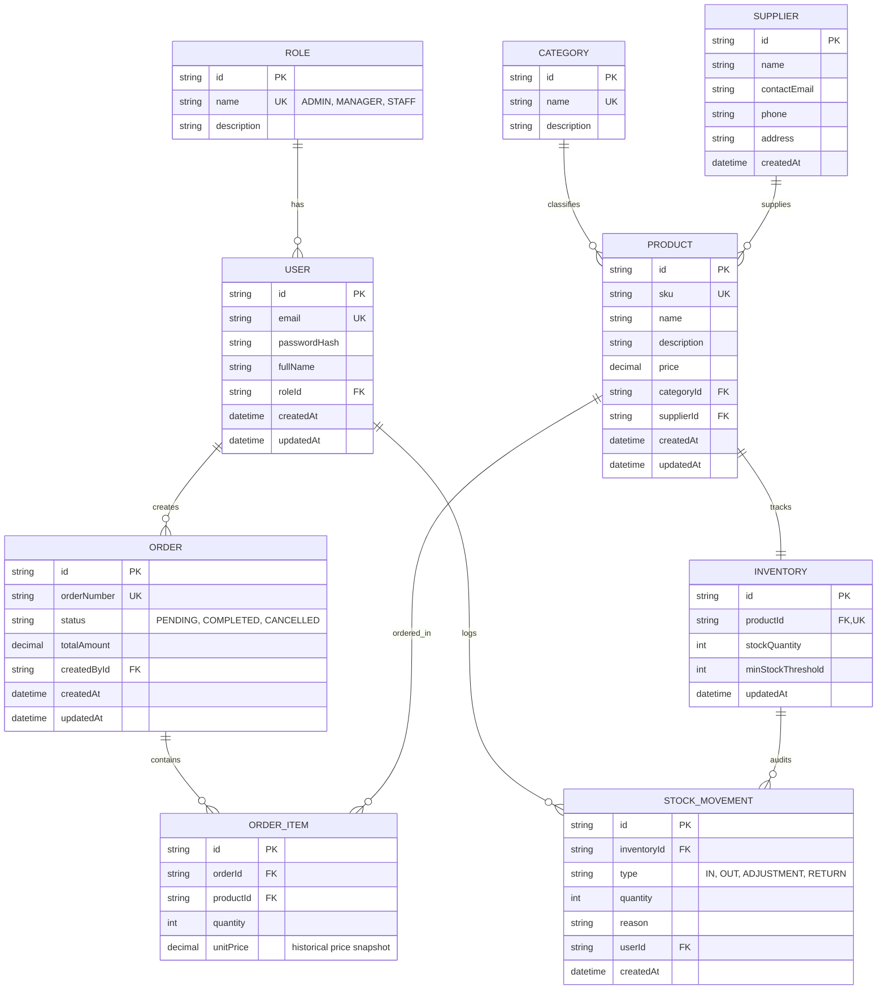

# Database Design

## Database
PostgreSQL

## ORM
Prisma

---

## Entity-Relationship (ER) Diagram

---

## Core Entities & Business Logic

### 1. User & Role (Authentication & RBAC)
* **`Role`**: Defines permissions (`ADMIN`, `MANAGER`, `STAFF`).
* **`User`**: System account holding credentials. Passwords are never stored in plaintext (hashed with `bcrypt` or `argon2`).

### 2. Category & Supplier
* **`Category`**: Logical grouping for products (e.g., Beverages, Bakery).
* **`Supplier`**: Vendors providing stock (contact details, phone, address).

### 3. Product & Inventory (1:1 Relationship)
* **`Product`**: Commercial item details (SKU, name, current selling price, category, supplier).
* **`Inventory`**: Current physical stock count and minimum threshold alert level. Separated from `Product` to cleanly isolate inventory state and audit tracking.

### 4. StockMovement (Immutable Audit Trail)
* Every change in stock (receiving a shipment, completing a customer order, reporting waste, or returning goods) logs a permanent, append-only row in `StockMovement`.
* Records *who* performed the action (`userId`), *how much* moved (`quantity`), and *why* (`reason`).

### 5. Order & OrderItem (Transactional Order Management)
* **`Order`**: Represents a purchase with a unique `orderNumber`, `status`, and `totalAmount`.
* **`OrderItem`**: Line items inside an order. Stores the **`unitPrice`** at the exact moment of purchase so historical revenue records remain immutable even if the product's selling price changes in the future.

---

## Database Principles
* **Primary Keys**: UUIDs used across all entities for distributed safety.
* **Foreign Keys**: Explicit relational constraints maintaining referential integrity.
* **Indexes**: Indexes on `sku`, `email`, `orderNumber`, and foreign keys for fast query performance.
* **Transactions**: Multi-step operations (e.g., Order creation + stock deduction + stock movement logging) are executed inside ACID transactions.
* **Migrations**: Managed strictly via Prisma migrations (`npx prisma migrate dev`).

